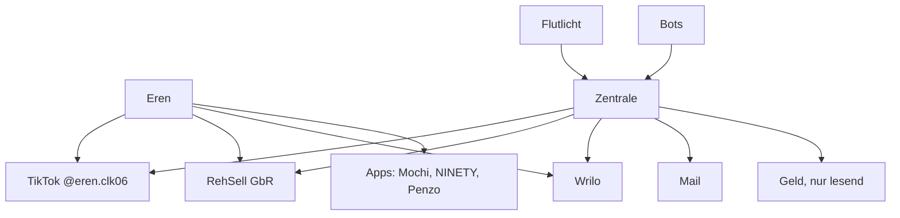

# Eren – alles auf einen Blick

> [!info] Was das hier ist
> Ein Vault mit dem Kontext über alles, was Eren macht: er selbst, TikTok, RehSell, Wrilo, die Zentrale, die Bots und die Apps.
> Jede Notiz hat ein `stand`-Datum. Was nicht belegt ist, steht unter **Offen** und ist nicht ausgedacht.

## Bereiche
| Bereich | Einstieg | Kurz |
|---|---|---|
| Ich | [[Profil]] | Wer Eren ist, wie er arbeitet, was er nicht will |
| TikTok | [[TikTok – Überblick]] | @eren.clk06, Fußball-Pov, eigener Vault |
| RehSell | [[RehSell – Überblick]] | GbR, PS5 Ankauf und Reparatur, rehsell.de |
| Wrilo | [[Wrilo – Überblick]] | Handschrift-App, wrilo.app, vor dem Store-Start |
| Zentrale & Server | [[Zentrale]] | zentrale.celikmedia.de, Server, Automationen |
| Bots & Team | [[Team-Übersicht]] | wer was macht |
| Weitere Apps | [[Apps – Überblick]] | Mochi, NINETY, Penzo |
| Geld | [[Konten und Geld]] | nur Zuordnung, keine Zahlen |
| Entscheidungen | [[Entscheidungen]] | was wann festgelegt wurde |
| Offen | [[Offene Punkte]] | alles, was noch fehlt |

Siehe auch [[So benutzt du den Vault]] · [[Projekte.base]]
