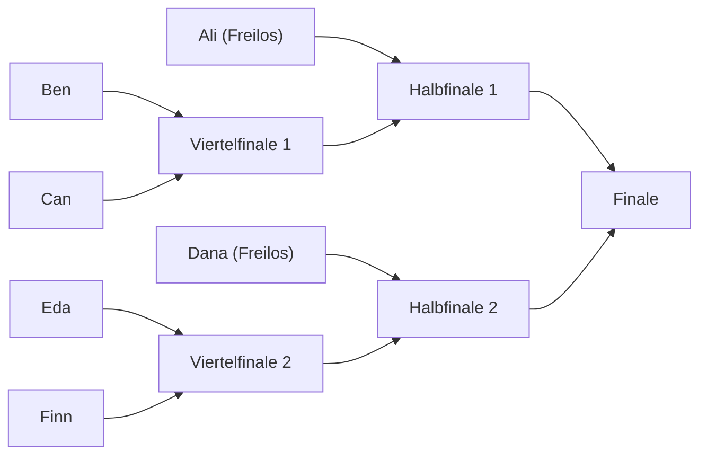

# Mensa-Rush – Burger-Turnier

> [!info] Kurz
> In der Abi-Gruppe wird ein Event angekündigt: Wer ist der beste Burgerbrater der Stufe? Alle treten bei, das Spiel baut automatisch einen Turnierbaum, jeder spielt 1 gegen 1, bis eine Person übrig ist. Alle anderen können live zuschauen. Der Sieg bringt 10 €.

Status: Idee, nichts davon ist gebaut. Zurück zum [[Ideen-Parkplatz]].

## So läuft der Abend ab

1. **Ankündigung:** Eren postet einen Link in die Abi-Gruppe, z. B. „Freitag 20 Uhr, Burger-Turnier, 10 € für den Sieg“.
2. **Anmeldung:** Link öffnen, echten Namen bestätigen, „Ich bin dabei“ drücken. Eine Liste zeigt, wer schon dabei ist.
3. **Üben:** Die Event-Küche ist vorher offen, mit anderen Kunden als im Turnier.
4. **Einchecken:** In den letzten 10 Minuten vor dem Start muss jeder „Ich bin da“ drücken. Nur wer eingecheckt ist, kommt in den Baum. So fallen die meisten Nichterscheiner schon vor der Auslosung weg.
5. **Auslosung:** Der Baum entsteht automatisch und wird für alle groß gezeigt.
6. **Turnier:** Die frühen Runden laufen gleichzeitig. Ab dem Viertelfinale läuft immer nur ein Match, damit alle dasselbe sehen.
7. **Finale:** Best of 3. Danach Siegerbild und ein Titel im Profil, z. B. „Bester Burgerbrater 2026“.

## Der 1-gegen-1-Modus

- **Gleiche Küche für alle:** Die Event-Küche hat eine feste Ausstattung. Gekaufte Upgrades zählen nicht, sonst gewinnt, wer am längsten gespielt hat.
- **Gleiche Kunden:** Beide bekommen in einem Match dieselben Kunden in derselben Reihenfolge. Es entscheidet nur das Können, kein Glück.
- **Endlos mit steigendem Tempo:** Die Kunden kommen immer schneller und werden immer ungeduldiger.
- **Ende:** Wer zuerst 3 Kunden verloren hat, verliert das Match.
- **Spätestens nach 3 Minuten ist Schluss.** Dann gewinnen die meisten Münzen. Bei Gleichstand gewinnt, wer weniger Kunden verloren hat. Ist auch das gleich, wer zuletzt schneller bedient hat.
- **Beide sehen den Gegner:** oben eine kleine Leiste mit seinen Münzen und seinen verlorenen Kunden.

## Turnierbaum und ungerade Zahlen

Die Lösung heißt **Freilos**: Der Baum wird auf die nächste Zweierpotenz aufgefüllt (8, 16, 32 …). Die leeren Plätze werden zu Freilosen. Wer eins hat, kommt ohne Spiel in Runde 2. Freilose gibt es nur in Runde 1, danach geht jede Runde glatt auf.

| Spieler | Baum | Runden | Freilose | Matches in Runde 1 | Matches gesamt |
|---|---|---|---|---|---|
| 8 | 8 | 3 | 0 | 4 | 7 |
| 12 | 16 | 4 | 4 | 4 | 11 |
| 13 | 16 | 4 | 3 | 5 | 12 |
| 20 | 32 | 5 | 12 | 4 | 19 |
| 30 | 32 | 5 | 2 | 14 | 29 |
| 40 | 64 | 6 | 24 | 8 | 39 |

Beispiel mit 6 Leuten: Der Baum hat 8 Plätze, also 2 Freilose.

**Wer bekommt die Freilose?**
- **Erste Version:** Das Los entscheidet, und zwar sichtbar bei der Auslosung.
- **Spätere Version:** Vor dem Turnier spielt jeder eine Aufwärmrunde. Die Besten bekommen die Freilose. Das ist fairer und prüft nebenbei, ob bei jedem das Handy und die Verbindung laufen.

**Dauer:** Gerechnet mit 4 Minuten pro Match samt Pause, frühe Runden gleichzeitig, ab Viertelfinale einzeln und Finale über 3 Spiele. Das ergibt je nach Größe etwa 35 bis 45 Minuten, für 8 bis 30 Leute. Das ist eine Schätzung, kein Messwert.

## Wenn jemand rausfliegt oder verlässt

Grundregel: **Jeder hat pro Match insgesamt 15 Sekunden Rückkehrzeit.** Die Zeit ist ein Vorrat und startet nicht bei jedem Abbruch neu. Sonst könnte jemand kurz vor der Niederlage immer wieder rausgehen, um Pausen zu erzwingen.

| Was passiert | Was das Spiel macht |
|---|---|
| Jemand fliegt im Match raus | Beide Küchen frieren ein. Beide sehen den Countdown. |
| Person ist rechtzeitig zurück | 3-2-1, dann geht es genau an derselben Stelle weiter. |
| Die 15 Sekunden sind aufgebraucht | Der Gegner gewinnt das Match. |
| Handy gesperrt, App gewechselt, Anruf | Zählt genauso. Vor dem Match kommt der Hinweis: Handy nicht sperren. |
| Beide fliegen raus | Es läuft für beide ein eigener Countdown. Wer zurückkommt, gewinnt, wenn der andere nicht auftaucht. |
| Beide bleiben weg | Wer in dem Moment besser stand, kommt weiter. Bei Gleichstand das Los. |
| Jemand erscheint nicht zum Match | 60 Sekunden „Bereit“-Zeit. Danach kommt der Gegner weiter. |
| Beide erscheinen nicht | Beide sind raus. Der nächste Gegner bekommt ein Freilos. |
| Der Server fällt aus | Der Baum ist gespeichert. Laufende Matches werden neu gespielt, fertige bleiben. |

**Knöpfe für Eren als Leiter:** Turnier pausieren, Match wiederholen, Sieger von Hand setzen, Person entfernen. Bei echtem Geld wird es immer einen Streitfall geben, den keine Regel vorhersieht.

## Zuschauen

- Jeder kann den Baum öffnen und auf ein laufendes Match tippen.
- Man sieht beide Küchen klein nebeneinander, darüber den Spielstand. Dazu die Zahl der Zuschauer.
- Zuschauer schicken Emojis, die kurz am Rand hochfliegen. Kein freier Chat, das spart Ärger mit Beleidigungen.
- Wer raus ist, landet automatisch als Zuschauer beim nächsten Match. So bleibt niemand nach 3 Minuten draußen stehen.
- Später möglich: vor dem Match auf den Sieger tippen, nur für Ehre oder Sterne, nie um Geld.

## Damit es fair bleibt

Das ist der wichtigste Punkt, sobald 10 € im Spiel sind.

- **Heute kann man schummeln:** Die Münzen werden vom Handy gemeldet, der Server prüft sie nicht. Für den normalen Modus ist das egal, fürs Turnier nicht.
- **Lösung:** Der Server legt die Kunden fest und führt die Uhr. Das Handy schickt nur, was der Spieler tut, also welche Zutat und welchen Teller. Der Server rechnet die Punkte selbst nach. Eine gemeldete Punktzahl zählt nie.
- **Zweitkonten:** Teilnahme nur über den Einladungslink der Gruppe und mit echtem Namen. Eren sieht die Liste vor dem Start und kann Leute entfernen.
- **Spielt Eren mit?** Wenn er selbst leitet und den Preis zahlt, sollte er besser nicht um die 10 € spielen oder es vorher offen sagen.

## Was es technisch braucht

| Baustein | Stand heute |
|---|---|
| Spielserver (Nakama) und Live-Verbindung | vorhanden, die Schul-Arena nutzt sie schon |
| Einladung über Link (`?kreis=`) und Namen | vorhanden |
| Gleiche Kunden für beide | im Ansatz da, die Kundenliste entsteht schon aus einer festen Zufallszahl |
| Spielregeln auf dem Server nachrechnen | fehlt, das ist der größte Brocken |
| Endlos-Modus und Event-Küche | fehlt |
| Baum, Einchecken, Freilose, Rückkehrzeit | fehlt |
| Zuschauer-Ansicht | fehlt |
| Leiter-Knöpfe | fehlt |
| Feste Adresse | fehlt, der jetzige Tunnel ändert sich bei einem Neustart. Für ein Event mit Ankündigung geht das nicht. |

**Sinnvolle Reihenfolge:**
1. Endlos-Modus für eine Person, damit man sieht, ob er Spaß macht.
2. 1 gegen 1 unter Freunden, ohne Baum und ohne Preis.
3. Regeln auf dem Server nachrechnen.
4. Baum, Freilose, Rückkehrzeit und Leiter-Knöpfe.
5. Zuschauen.
6. Probe-Turnier mit Test-Bots, dann mit 4 bis 6 echten Leuten.
7. Erst dann das Event mit Preis in der Abi-Gruppe.

## Risiken

- **Echte Handys:** Das Spiel wurde noch nicht auf echten iPhones getestet, schon gar nicht mit vielen gleichzeitig. Schwache Handys oder schlechtes WLAN wären im Match ein echter Nachteil.
- **Geld:** Teilnahme kostenlos und Preis aus Erens Tasche ist der einfache Fall. Ein Startgeld pro Person sollte vorher geprüft werden, weil Einsatz plus Geldpreis rechtlich etwas anderes sein kann.
- **Marke:** Spielidee und Ablauf sind eigen. Kein Name, kein Bild und keine Figur aus Cooking Fever.

## Später denkbar

- Spiel um Platz 3.
- Zweite Chance für Verlierer der ersten Runde (Doppel-K.-o.).
- Küche wechselt von Runde zu Runde, das Finale läuft im Abiball-Buffet.
- Dasselbe Turnier-System für Spind Blast.
- Pokal für den Sieger sichtbar in der 3D-Schule.

## Offen

- [ ] Reicht als Ende „3 Kunden verloren“, oder lieber fest 2 Minuten und die meisten Münzen?
- [ ] Wie viele Leute aus der Abi-Gruppe würden mitmachen?
- [ ] Spielt Eren selbst mit?
- [ ] Bleibt es bei 10 € oder gibt es einen anderen Preis?
- [ ] Sollen die 15 Sekunden so bleiben? Das muss ein echter Test zeigen.
